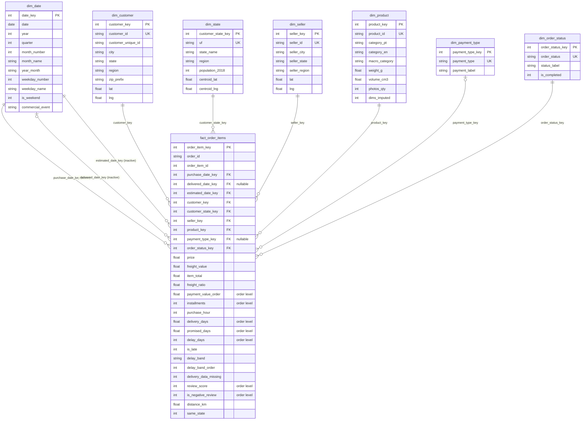

# 04 — Star schema

Model that the pipeline generates in `data/processed/`: one fact table (`fact_order_items`) and seven dimensions. Each column is described in [`02-data-dictionary.md`](02-data-dictionary.md). `analytics_flat.csv.gz` (flat table for the notebook) and `data_quality_report.csv` (log) are **not** part of the star schema.

## 1. Diagram

Notation: `||--o{` = one-to-many with a mandatory foreign key; `|o--o{` = one-to-many with a nullable foreign key. PK = primary key, FK = foreign key, UK = unique natural key.

## 2. Relationships

The 9 relationships go from the dimension (one side) to the fact table (many side). All of them have a **single filter direction** (the dimension filters the fact table, never the other way around). There are three relationships with `dim_date` (one per date role): **one active** and **two inactive**, which are activated inside a measure with `USERELATIONSHIP`.

| # | Dimension (key, one side) | Fact (foreign key, many side) | Cardinality | Direction | Status | Nulls in the foreign key |
| --: | :-- | :-- | :-- | :-- | :-- | :-- |
| 1 | `dim_date.date_key` | `fact_order_items.purchase_date_key` | 1:* | Single (dim → fact) | **Active** | No |
| 2 | `dim_date.date_key` | `fact_order_items.delivered_date_key` | 1:* | Single (dim → fact) | **Inactive** (`USERELATIONSHIP`) | Yes: no valid delivery (2407 lines) |
| 3 | `dim_date.date_key` | `fact_order_items.estimated_date_key` | 1:* | Single (dim → fact) | **Inactive** (`USERELATIONSHIP`) | No |
| 4 | `dim_customer.customer_key` | `fact_order_items.customer_key` | 1:* | Single (dim → fact) | Active | No |
| 5 | `dim_state.customer_state_key` | `fact_order_items.customer_state_key` | 1:* | Single (dim → fact) | Active | No |
| 6 | `dim_seller.seller_key` | `fact_order_items.seller_key` | 1:* | Single (dim → fact) | Active | No |
| 7 | `dim_product.product_key` | `fact_order_items.product_key` | 1:* | Single (dim → fact) | Active | No |
| 8 | `dim_payment_type.payment_type_key` | `fact_order_items.payment_type_key` | 1:* | Single (dim → fact) | Active | Yes: order without valid payments (0 lines in the last run) |
| 9 | `dim_order_status.order_status_key` | `fact_order_items.order_status_key` | 1:* | Single (dim → fact) | Active | No |

- `dim_date` is marked as a date table (column `date`) in Power BI.
- The `validate` stage guarantees that no non-null foreign key is orphaned (`fact_no_orphans`), that the dimension keys are unique (`dim_keys_unique`) and that `dim_customer`, `dim_seller` and `dim_product` only contain used keys (`csp_dims_only_used_keys`).
- There are no relationships between dimensions (star schema, not snowflake). `dim_customer.state` and `dim_state.uf` match on every line by construction: the `customer_state_key` key is taken from the UF of the order's customer.

## 3. Keys

| Table | Primary key | Natural key | Rule |
| :-- | :-- | :-- | :-- |
| `fact_order_items` | `order_item_key` | `order_id` + `order_item_id` (unique) | Position 1..n after sorting by `order_id`, `order_item_id` |
| `dim_date` | `date_key` | `date` | Natural: YYYYMMDD (for example `20171124`) |
| `dim_customer` | `customer_key` | `customer_id` | Surrogate 1..n in ascending order of the natural key |
| `dim_state` | `customer_state_key` | `uf` | Surrogate 1..27 in alphabetical order of `uf` |
| `dim_seller` | `seller_key` | `seller_id` | Surrogate 1..n in ascending order of the natural key |
| `dim_product` | `product_key` | `product_id` | Surrogate 1..n in ascending order of the natural key |
| `dim_payment_type` | `payment_type_key` | `payment_type` | Fixed catalog 1–4 |
| `dim_order_status` | `order_status_key` | `order_status` | Fixed catalog 1–8 |

Surrogate keys are deterministic integers: with the same inputs, every run assigns the same keys. There are no "unknown" members: the nullable foreign keys (`delivered_date_key`, `payment_type_key`) are left empty.

**Grain:** one order line. Order-level measures (orders, average ticket, average delay, average score) must be aggregated by `order_id` (`DISTINCTCOUNT` / `AVERAGEX`), because the order fields are repeated on every line (see `docs/02`, section 12).

## 4. Geographic hierarchy

- The drill-down hierarchy is **`region` → `state` → `city`**, entirely within `dim_customer` (location of the order's customer).
- `dim_state` is not part of that hierarchy: it provides the **2018 population** (`population_2018`) and the state **centroids** (`centroid_lat`, `centroid_lng`) for per-capita indicators and state maps.

## 5. Deviations from the guide's schema (section 6.6)

| Topic | Implementation | Reason |
| :-- | :-- | :-- |
| Dimension contents | `dim_customer`, `dim_seller` and `dim_product` only with the keys used by the fact table | No rows without facts in the model |
| Grain of `dim_customer` | One row per `customer_id` (in Olist, one per order); `customer_unique_id` as an attribute to count distinct customers and measure repeat purchases | City, ZIP and coordinates consistent with the order of each line |
| Foreign keys | 9 in the fact table, with three date roles (purchase active; delivery and estimated inactive) and `customer_state_key` to `dim_state` | Analysis by delivery or estimated date and by state population |
| Nulls in foreign keys | `delivered_date_key` and `payment_type_key` allow nulls, with no "unknown" members | No invented dates or payment types |
| Order statuses | The fact table keeps every status; `dim_order_status.is_completed` = 1 only for `delivered` | Delivery metrics are filtered without losing the GMV of other statuses |
| Columns added to the fact table | `purchase_hour`, `delay_band_order` and `delivery_data_missing` (and `dims_imputed` in `dim_product`) | Band order, single invalid-delivery flag and imputation traceability |

## 6. Power BI semantic model

The star schema is loaded into `apps/bi-dashboard/ECBD_Olist_Dashboard.SemanticModel` (TMDL). Only the 8 star-schema tables are imported through the text parameter `DataPath` (the local path of `data/processed/`, ending with a backslash); `analytics_flat.csv.gz` and the quality log are not imported.

| Element | Implementation |
| :-- | :-- |
| Relationships | The 9 relationships of section 2, one-to-many and single direction; `purchase_date_key` active, `delivered_date_key` and `estimated_date_key` inactive (used with `USERELATIONSHIP`) |
| Date table | `dim_date` marked as date table on `date`; auto date/time disabled |
| Sort by column | `month_name` by `month_number`, `weekday_name` and `weekday_short` by `weekday_number`, `delay_band` and `delay_band_name` by `delay_band_order`, `month_label` by `year_month`, `quarter_label` by `quarter` |
| Hidden | The 9 foreign keys and `order_item_key`, every surrogate key, `dim_customer[region]` and the whole `dim_state` table |

**Calculated columns (display only; source data and the ETL are unchanged):**

| Column | Expression (summary) | Purpose |
| :-- | :-- | :-- |
| `dim_customer[state_name]` | `LOOKUPVALUE` of `dim_state[state_name]` by UF | State name for titles |
| `dim_customer[state_full]` | `state_name & ", Brazil"` | Unambiguous location for Azure Maps and the drill-through field |
| `dim_customer[region_name]` | Norte North, Nordeste Northeast, Centro-Oeste Central-West, Sudeste Southeast, Sul South | English region labels |
| `dim_product[macro_name]` | `uncategorized` shown as Uncategorized | Display label |
| `dim_product[category_name]` | `category_en` without underscores, capital first letter | Display label |
| `dim_payment_type[payment_name]` | Boleto shown as Bank slip (boleto) | English payment label |
| `dim_date[month_label]`, `quarter_label`, `weekday_short` | `MMM yyyy` (en-US), `Q1` to `Q4`, three-letter weekday | Axes and slicers |
| `fact_order_items[delay_band_name]` | 10+ days early, 1 to 9 days early, On time to 3 days late, 4 to 10 days late, Over 10 days late | Readable delay bands |

**Hierarchies:** Customer geography (Region → State → City, on `region_name`, `state_full`, `city`), Product (Macro category → Category, on `macro_name`, `category_name`) and Date hierarchy (Year → Quarter → Month → Date; named "Date hierarchy" because a hierarchy cannot share the name of the `date` column).

**Measures:** the calculated table `_Measures` (`ROW ( "x", 0 )`, column hidden) holds 61 measures in the display folders Commercial, Penetration, Logistics, Satisfaction, Cost, Time, Target and Presentation. GMV is the sum of `price` (freight excluded) for non-canceled orders; order-level measures use `DISTINCTCOUNT` or `AVERAGEX` over `order_id`; own filters use `KEEPFILTERS`; filters on `is_late = 0` use strict equality (`==`) so non-evaluated orders (blank `is_late`) are excluded. Every measure is listed with a comment in `apps/bi-dashboard/dax/measures.dax`.

**Late rate target parameter:** the calculated table `'Late Rate Target'` (`GENERATESERIES` 0 to 20 %, step 1 %, `ParameterMetadata`) feeds the single-select slicer "Late rate target"; the measure `Late Rate Target` defaults to 8 % (a team assumption, not Olist data).

**Lineage:** source CSV (`data/raw/`) → ETL (`packages/etl`, documented in `docs/02`) → star schema (`data/processed/`) → measure (`dax/measures.dax`) → visual (page and visual listed in `apps/bi-dashboard/README.md`). The KPI figures are cross-checked against `apps/bi-dashboard/validation/kpi_reference.csv`, built by `scripts/kpi_reference.py` from the same processed files.
